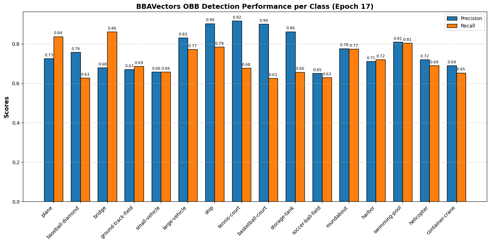
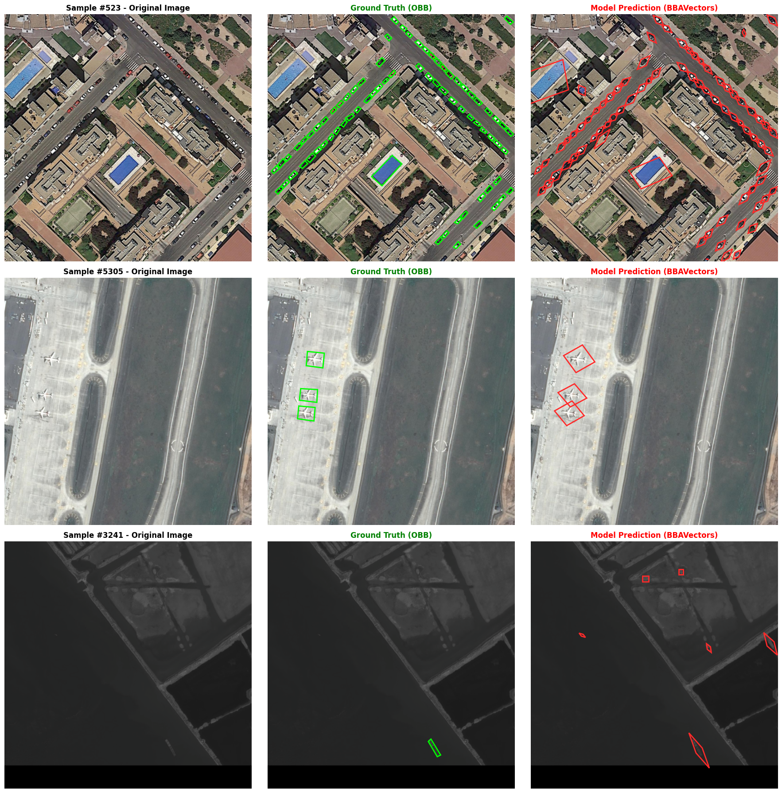

# BBAVectors: Oriented Object Detection in Aerial Images
**A robust, PyTorch-based implementation of Box Boundary-Aware Vectors for Oriented Object Detection.**

## Project Overview
This repository contains a full-pipeline implementation of the paper **"Oriented Object Detection in Aerial Images with Box Boundary-Aware Vectors" (BBAVectors)**. The project goes beyond a simple code reproduction; it demonstrates a complete end-to-end engineering pipeline, from handling normalized YOLO-OBB dataset formats (DOTA-v1.5) to custom Mixed Precision (AMP) training, and advanced Polygon NMS evaluations.

##  Theoretical Foundation & Paper Intuition
Traditional anchor-based detectors struggle with aerial images due to the severe imbalance of positive/negative samples and the computational overhead of rotating anchors. While one-stage anchor-free methods like CenterNet attempt to directly regress width, height, and angle $(w, h, \theta)$, they often fail because the angle metric behaves differently in various quadrant systems, leading to severe IoU degradation with minor angle errors.

**The BBAVectors Innovation:**
Instead of regressing the angle, this architecture defines **Box Boundary-Aware Vectors** $[t, r, b, l]$ distributed in four quadrants of a Cartesian coordinate system relative to the object's center. 
To handle corner cases where objects align perfectly with the axes, the model introduces an **Orientation Classification Head ($\alpha$)** that categorizes bounding boxes into Horizontal (HBB) and Rotated (RBB).

## Architecture Design
The network is structured in a highly modular, U-shaped anchor-free paradigm:

1. **Backbone (`ResNet101`)**: Extracts multi-scale feature maps $(C_2, C_3, C_4, C_5)$ pretrained on ImageNet.
2. **U-Net Decoder**: Fuses deep semantic features with shallow, high-resolution features via bilinear upsampling and skip-connections. Outputs a unified feature map at $152 \times 152$ resolution (stride $s=4$).
3. **Multi-Task Prediction Heads**:
   * **Heatmap Head ($P$)**: Predicts center points for 16 classes (DOTA-v1.5). Uses a **Variant Focal Loss** with a carefully initialized bias $(-2.19)$ to prevent early training divergence.
   * **Offset Head ($O$)**: Regresses center sub-pixel quantization errors using Smooth $L_1$ Loss.
   * **Box Parameter Head ($B$)**: Outputs 10 parameters (8 for $t, r, b, l$ vectors + 2 for external $w_e, h_e$) via Smooth $L_1$.
   * **Orientation Head ($\alpha$)**: Binary classification (HBB vs. RBB) using BCE Loss.

##  Key Engineering Contributions
This implementation addresses several critical engineering challenges often omitted in academic papers:

* **AMP & BCE Loss Safety**: Implemented `torch.amp.autocast` for optimal VRAM usage (enabling training on standard Colab GPUs). Specifically engineered a bypass for the Orientation Head's BCE Loss to execute in `float32`, preventing `NaN` gradient explosions caused by half-precision sigmoid activations.
* **Strict Shape Contracts**: Enforced rigorous tensor dimension tracking throughout the `forward` pass, ensuring seamless concatenation during the U-Net decoding phase.
* **YOLO-OBB Denormalization Engine**: Built a custom `Dataset` class capable of dynamically translating normalized YOLO-OBB coordinates into absolute scaled targets, mapping them directly to the $152 \times 152$ heatmap output space.

##  Model Evaluation & Analytics
A comprehensive evaluation module was engineered to analyze the model's performance beyond standard loss metrics. The evaluation pipeline utilizes `shapely` for rigorous Polygon Intersection-over-Union (IoU) calculations.

### Quantitative Performance
The model was trained for **17 Epochs** on the DOTA-v1.5 dataset. The Variant Focal Loss successfully mitigated the background imbalance, dropping steadily to $<0.6$, while the Box regression loss stabilized, indicating accurate vector representations.

*(Evaluation metrics across different aerial classes)*

### Qualitative Visual Inference
The custom inference engine applies a robust **Greedy Polygon NMS (IoU threshold = 0.1)** to suppress redundant predictions. Below is a side-by-side comparison illustrating the model's precision in extracting dense, heavily rotated objects compared to the Ground Truth.

*(Red/Magenta: Model Predictions | Green: Ground Truth OBB)*

